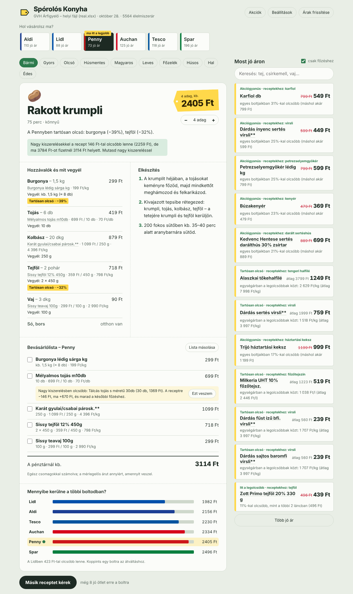
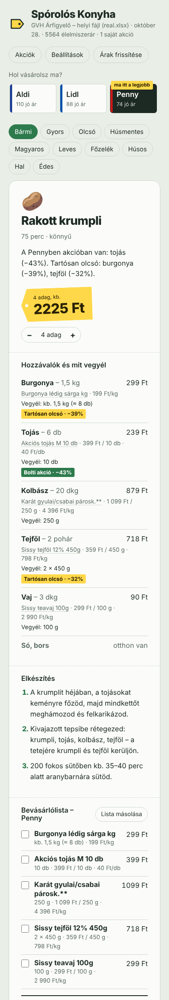
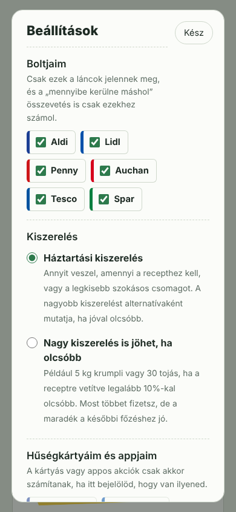
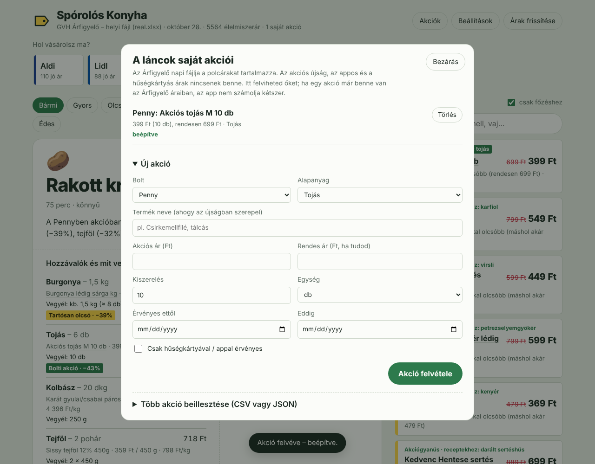
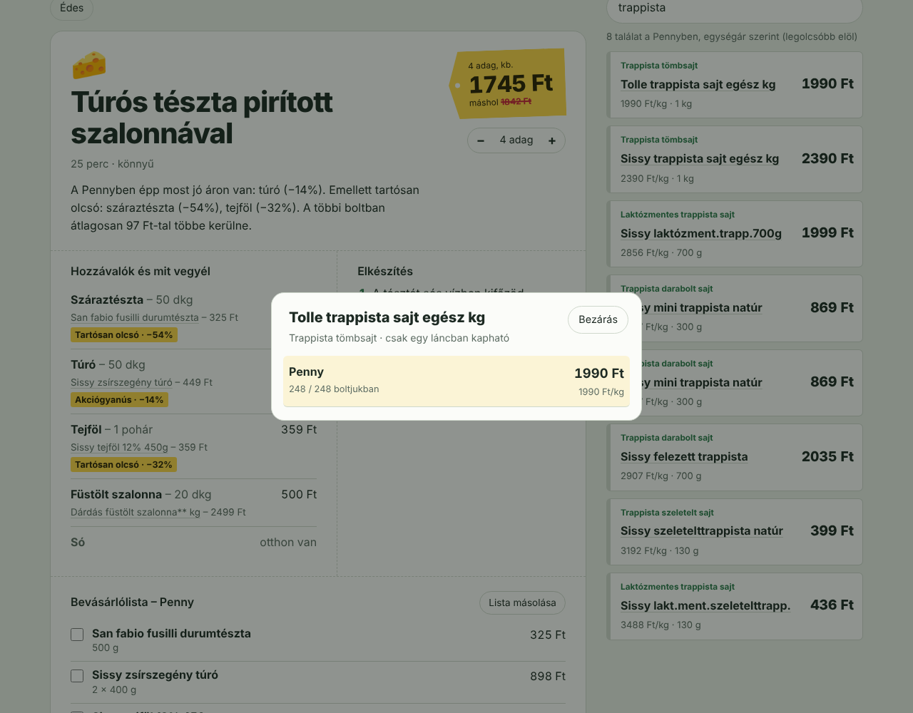

# Spórolós Konyha 🏷️

[](https://github.com/vereszsolt06/teszt/actions/workflows/build.yml)

Böngészős receptajánló, ami a **GVH Árfigyelő** napi árai alapján megmondja: *ha ma ebben a boltban vásárolsz, mit érdemes főzni?* Kiválasztod a boltot, és az app olyan recepteket „dobál”, amelyekhez ott épp kiemelkedően jó áron kapod az alapanyagokat. Minden hozzávalónál látod, melyik konkrét terméket vedd meg, mennyibe kerül, és miért jó az ára. Van hozzá kipipálható bevásárlólista is, és egy összevetés arról, mennyibe kerülne ugyanez a többi láncban. A nem kedvelt boltok kizárhatók. Alapból háztartási kiszerelésben vásárol, a nagy kiszerelést csak alternatívaként ajánlja. A láncok saját akciói (újság, app, hűségkártya) is felvihetők.

Java 21-ben írva, **külső függőség nélkül** (beépített JDK webszerver, saját JSON- és xlsx-olvasó), így egyetlen JAR-ként fut.



 

 

## Indítás

Kell hozzá: **JDK 21 vagy újabb** (pl. [Adoptium Temurin](https://adoptium.net/)).

```bash
# Linux / macOS
./build.sh run

# Windows
build.cmd run
```

Ezután nyisd meg: **http://localhost:8080**

Induláskor az app letölti a napi Excelt (`https://cdnarfigyeloprodweu.azureedge.net/excel/arfigyelo_napi_termekadatok.xlsx`), és elmenti a `data/` mappába. 6 óránként a háttérben újratölti. Ha nincs internet, a legutóbb letöltött példányt használja; ha az sincs, demó árakra vált (ezt a fejléc és egy sárga sáv is jelzi). Egy már betöltött valós árállapotot egy sikertelen frissítés sosem cserél demóra.

**Telefonról:** indítsd `HOST=0.0.0.0 ./build.sh run`-nal, és a telefon böngészőjében nyisd meg a gép helyi IP-címét (pl. `http://192.168.1.20:8080`). A „Hozzáadás a kezdőképernyőhöz” menüponttal alkalmazásként is elmenthető.

Csak fordítás: `./build.sh` → `target/sporolos-konyha.jar`, ami `java -jar target/sporolos-konyha.jar`-ral indítható. A GitHub Actions minden pushnál lefordítja és teszteli a projektet, a kész JAR-t pedig letölthető artifactként csatolja. IntelliJ / Eclipse alatt a `pom.xml`-lel Maven-projektként is megnyitható (`hu.sporolos.App` a főosztály).

### Beállítások

Parancssorból (`-Dport=9000`), környezeti változóval (`PORT=9000`) vagy egy `app.properties` fájllal a munkakönyvtárban:

| Kulcs | Környezeti változó | Alapérték | Mire jó |
|---|---|---|---|
| `port` | `PORT` | `8080` | webszerver portja |
| `host` | `HOST` | `127.0.0.1` | `0.0.0.0`-val a helyi hálózatról (pl. telefonról) is elérhető |
| `source` | `SOURCE` | `auto` | `auto` / `arfigyelo` (csak valós adat) / `demo` |
| `arfigyelo.file` | `ARFIGYELO_FILE` | – | kézzel letöltött Excel útvonala; ha létezik, nem tölt le |
| `arfigyelo.url` | `ARFIGYELO_URL` | GVH CDN | a napi Excel címe |
| `data.dir` | `DATA_DIR` | `data` | letöltött Excel és árelőzmények helye |
| `refresh.hours` | `REFRESH_HOURS` | `6` | ennyi óránként tölti újra az árakat |
| `promo.dir` | `PROMO_DIR` | `data/akciok` | a láncok saját akcióinak mappája (`*.json`, `*.csv`) |
| `promo.feeds` | `PROMO_FEEDS` | – | akció-feedek URL-jei vesszővel elválasztva (ugyanilyen JSON/CSV) |

## Mit tud

- **Boltválasztó** a hat élelmiszerlánccal; a „ma itt a legjobb” címke azt a boltot jelöli, ahol ma a legjobb receptet lehet összevásárolni.
- **Boltjaim** (Beállítások): a nem kedvelt láncok kizárhatók. Ilyenkor nem jelennek meg, és a „mennyibe kerülne máshol”, a megtakarítás, valamint a „ma itt a legjobb” is csak a választott boltokhoz számol. A beállítás a böngészőben megmarad.
- **Kiszerelés** (Beállítások): alapból háztartási kiszerelés, alternatívaként a nagy kiszerelés (lásd lent); átkapcsolható „nagy kiszerelés is jöhet” módra.
- **A láncok saját akciói** („Akciók” gomb): kézzel vagy CSV/JSON-ból felvihetők, és a hűségkártyás/appos akciók csak bekapcsolt kártyával számítanak (lásd lent).
- **Receptdobáló:** elsőre a legjobb recept, a „Másik receptet kérek” gomb a legjobb 8 közül húz súlyozott véletlennel, ismétlés nélkül. Szűrők: gyors, olcsó, húsmentes, magyaros, leves, főzelék, húsos, hal, édes.
- **Hozzávalók:** minden hozzávalónál a választott konkrét termék, a receptre jutó ár, és ha épp jó áron van, annak oka.
- **Bevásárlólista:** egész csomagokkal (pl. „2 × 450 g”), mérlegelős áruknál a szükséges tömeggel és darabszámmal („kb. 250 g (≈ 2 db)”). Minden sornál kiírja, mire szól az ár (Ft/kg, Ft/db vagy Ft/csomag). Kipipálható, megosztható. Ahol nagy kiszerelésben olcsóbb, ott soronként „Ezt veszem” gombbal átváltható, és a végösszeg azonnal frissül. Az olaj, a liszt és a cukor külön, „ha nincs otthon” tételként szerepel.
- **Adagszám** állítása 1–20 adag között, minden ár újraszámolva.
- **„Mennyibe kerülne a többi boltodban?”**: a recept ára a választott láncokban; egy koppintással átváltasz a másik boltra ugyanazzal a recepttel.
- **Termékrészletek:** bármelyik termékre koppintva látod az árát minden láncban, hány boltjukban kapható, és mennyi a legdrágább boltjukban.
- **Keresés** a kiválasztott bolt termékei között, egységár szerint rendezve.
- **Összes recept** böngészése ajánlás, ár (adagonként) vagy elkészítési idő szerint.
- **Megosztható link:** a cím tartalmazza a boltot, a receptet és az adagszámot (pl. `#bolt=tesco&recept=gulyasleves&adag=8`).

## Hogyan működik

### 1. Adatok – mit tartalmaz pontosan az Árfigyelő Excel?
A napi fájl egyetlen munkalap, soronként egy **termék × üzletlánc** páros (a 2026-10-28-i fájlban 25 443 sor). Minden árnál ott van, melyik üzletláncra vonatkozik. Konkrét boltot (címet) viszont nem tartalmaz: a lánc **legolcsóbb és legdrágább boltjának** ára szerepel benne, és hogy a lánc hány boltjában kapható. Oszlopok: vonalkód, név, hivatalos kategória (pl. 18 = Csirkemellfilé), lánc, egység (kg / l / db), kiszerelés, minimum és maximum ár, minimum és maximum egységár, hány láncban kapható, hány boltban kapható, a lánc összes boltja.

Amit ebből az app kihoz:

- **Élelmiszer-szűrés:** csak az 1–122. kategóriát tartja meg (5 564 sor), a drogériás tételeket (sampon, pelenka) eldobja. A Rossmann, a dm és a Müller kevés élelmiszert tart, ezért a boltválasztóban nem jelennek meg; a termékek láncok közötti összevetésében viszont szerepelnek.
- **Elérhetőség:** a „Hány boltban elérhető / Üzletlánc összes boltja” arányból. A diszkontláncok (Aldi, Lidl, Penny) szinte mindent minden boltban tartanak, egységes áron. A Sparnál viszont 317 élelmiszer a boltok kevesebb mint 20%-ában kapható (jellemzően csak az Interspar tartja). Az ilyen termékeket az app alapanyagnak és jó árnak is visszafogottabban ajánlja, és kiírja, hogy „csak a boltjaik X%-ában kapható”.
- **Láncon belüli árszórás:** a Spar 102 élelmiszerénél a legolcsóbb bolti ár legalább 12%-kal a legdrágább alatt van, sokszor feleannyi. Ilyen például a Don Francesco spagetti, ami 294 Ft a legolcsóbb és 699 Ft a legdrágább boltjukban; az Auchanban 715 Ft. Ezek jellemzően a lánc aktuális akciói, ezért ez *„Akciógyanús”* jelzést kap.
- **Adathibák kezelése:** az egységárat a csomagárból számolja, mert a fájl egységár-oszlopa néhány sorban hibás (pl. egy 26 g-os teánál a csomagár szerepel benne). Néhány termék rossz kategóriában van (pl. trappista sajt a natúr joghurtok közt); ezeket kizáró kulcsszavak szűrik ki.
- Az oszlopokat a **fejléc szövege alapján** keresi meg, így egy oszlopsorrend-változás nem töri el. Az xlsx-et folyamatosan (StAX) olvassa: kb. fél másodperc, néhány tíz MB memória.

### 2. Mi számít „kiemelkedően jó árnak”?
Minden bolti árra négy jelet néz, és a legerősebbet tartja meg (`DealAnalyzer`):

| Jel | Felirat | Mikor | Súly |
|---|---|---|---|
| CHAIN | *Itt a legolcsóbb* | ugyanaz a termék (vonalkód) ebben a láncban ≥ 8%-kal olcsóbb a többi lánc mediánjánál, és itt a legolcsóbb | teljes |
| HISTORY | *Olcsóbb a szokásosnál* | ≥ 8%-kal olcsóbb, mint az elmúlt napokban (helyi előzményekből, min. 3 nap kell) | teljes |
| SPREAD | *Akciógyanús* | a lánc legolcsóbb boltjában ≥ 12%-kal olcsóbb, mint a legdrágábban | 80% |
| CATEGORY | *Tartósan olcsó* | egységárban a kategória legolcsóbb 5%-ában van, és ≥ 30%-kal a medián alatt | 40% |

Ha a termék a lánc boltjainak kevesebb mint felében kapható, a pontszám arányosan csökken. Az Excel csak az adott napot tartalmazza, ezért az app **minden nap elmenti a láncok árait** (`data/history/ÉÉÉÉ-HH-NN.tsv`). Néhány nap futás után így azt is felismeri, ha valami *épp most* olcsóbb a szokásosnál.

### 3. Receptajánlás és bevásárlás
55 hétköznapi, főleg magyaros recept van beépítve (`src/main/resources/data/recipes.json`): levesek, főzelékek, egytálételek, sült húsok, halak, saláták, desszertek. Minden hozzávaló abszolút mennyiséggel szerepel (kg / l / db). Az alapanyagok az Árfigyelő **kategóriáihoz** vannak kötve (`products.json`), pl. „darált hús” → 85-ös kategória, „spagetti” → 50-es kategória + „spagett” a névben.

A `RecipeRecommender` minden receptet „megvásárol” minden boltban.

#### Darab vagy kiló? (`Packaging`)
Az Árfigyelő ugyanazt a fajta árut háromféleképpen adja meg, és ezeket szigorúan külön kell kezelni:

| Fajta | Példa a fájlból | Mire szól az ár | Mit veszel |
|---|---|---|---|
| **mérlegelős** | „Paprika tv lédig”, „Csirkecomb Ft/kg”, „Húsmester csirkecomb egész kg vákuumcsomagolt” | 1 kg | annyit, amennyi kell, de legalább egy darabot (1 dkg fokhagymához egy egész fejet) |
| **csomagolt** | „Zöldborsó 450 g”, „Tojás 10 db”, „TV paprika 3 db”, „Karfiol db”, „Zsemle 52 g” | a csomag | egész csomagot; 15% tűréssel (0,5 kg-hoz elég egy 450 g-os) |
| **kilós árú csomag** | „Füstölt szalonna, ca. 500g”, „Trappista sajt ca1,4kg” | 1 kg | egész csomagot, a névben szereplő tömeggel |
| **csomós** | „Sárgarépa csomós”, „Csomós petrezselyemgyökér 5 db” | egy csomó | egész csomót (kb. 50 dkg), az egységtől függetlenül |

A darab és a kiló között a katalógus átlagos darabtömegeivel vált (paprika 15 dkg, uborka 40 dkg, hagyma 12 dkg, karfiol 1 kg, zsemle 5,5 dkg). Az alapanyagok egy része **csak csomagolva kapható** (liszt, tej, tejföl, kenyér, tészta stb.). Ezeknél egy kilós egységű, tömeg nélküli sor (pl. „Penny finomliszt”, 178 Ft) egy 1 kg-os csomag, nem 3 dkg lisztre lebontható kilóár.

#### Háztartási kiszerelés, nagy kiszerelés alternatívaként
Minden alapanyagnak van egy **háztartási felső határa** (`maxPack`: burgonya 2,5 kg, tojás 15 db, liszt 1 kg, trappista 60 dkg…). Az ennél nagyobb csomag (5 kg krumpli, 30 tojás, 1,4 kg-os sajttömb) csak akkor nem számít nagy kiszerelésnek, ha a recept (pl. 20 adag) ennyit kér.

- **Alapból** a háztartási kiszerelések közül választ: a felhasznált rész ára + a kényszerűen megvett maradék 35%-a számít. A recept ára ebből jön, így egy 10 kg-os zsák nem teszi olcsóbbá a receptet.
- Ha egy nagy kiszerelés a receptre vetítve **legalább 10%-kal (és 15 Ft-tal) olcsóbb**, a bevásárlólistán alternatívaként jelenik meg. Mellette ott van, mennyivel olcsóbb a recept, és mennyivel többet fizetsz ma. A recept fejlécében egy összesítő is jelzi, mennyi lenne nagy kiszerelésekkel.
- A **„Nagy kiszerelés is jöhet”** beállítással fordítva működik: a legolcsóbb egységárat választja, a háztartási pedig az alternatíva.
- A ritkán kapható csomagokat (pl. a Tesco 5 kg-os, 981 Ft-os zsákja csak 6/197 boltjukban van) ilyenkor is hátrébb sorolja.

#### Pontozás
**45%** mennyire épül jó árakra (a jel erősségével súlyozva), **35%** mennyivel olcsóbb itt, mint a többi választott bolt mediánjával, **20%** hány hozzávalóra van valós bolti ár.

### 4. A láncok saját akciói
#### Mennyire lehetséges az integráció?
Megvizsgáltam, mi van benne az Árfigyelőben, és mi nincs:

- Az Árfigyelő **weboldala** üzletenként tárolja az árakat, és jelöli az akciót, valamint a „törzsvásárlói” árat ([GVH Árfigyelő GYIK](https://arfigyelo.gvh.hu/docs/arfigyelo_GYIK.pdf)). A **napi Excel** viszont csak láncszintű minimum/maximum árat ad, akciójelölés és hűségkártyás ár nélkül. Ha egy akció a polcárat csökkenti, az a minimum árban többnyire benne van (ezt jelzi az *Akciógyanús* jel). Az **appos és hűségkártyás árak** (Lidl Plus, Tesco Clubcard, SPAR/PENNY app) és az **újságos ajánlatok érvényessége** viszont nincs benne.
- A láncok akcióit **nyilvános, dokumentált API nem** adja. Az akciós újság PDF vagy lapozható web, az ajánlatok a láncok weboldalain és webshopjaiban (Tesco, Auchan, Spar online) belső, dokumentálatlan végpontokon érhetők el. Ezek automatikus letöltése a felhasználási feltételekbe ütközhet, és bármikor eltörhet. Erről a fejlesztői gépről ráadásul nem is elérhetők, így nem lehetett volna megbízhatóan tesztelni.

**A döntés:** az app egy **akcióréteget** kapott, ami bármilyen forrásból fogad akciókat. A lánc-specifikus letöltők így később külön, cserélhetően hozzáadhatók, a többi kódhoz nem kell nyúlni:

1. **Kézzel** a felületen („Akciók” → Új akció): bolt, alapanyag, terméknév, ár, kiszerelés, rendes ár, érvényesség, kártyás-e.
2. **Beillesztve** CSV-ből vagy JSON-ból („Több akció beillesztése”), pl. egy akciós újságból kimásolt listát. Minta: [`docs/akciok-minta.csv`](docs/akciok-minta.csv).
3. **Fájlból:** minden `*.csv` és `*.json` a `data/akciok/` mappában (a kézi akciók a `sajat-akciok.json`-ba kerülnek).
4. **Feedből:** `PROMO_FEEDS=https://…` – bármilyen URL, ami ugyanezt a JSON-t vagy CSV-t adja. Ez lehet egy közösen karbantartott lista, vagy egy saját szkript kimenete, ami egy lánc oldaláról gyűjt. A legutóbbi sikeres letöltést elmenti, így net nélkül is megmarad.

CSV-fejléc: `bolt;termek;ar;egyseg;kiszereles;rendes_ar;tol;ig;alapanyag;vonalkod;kartya`. Az `alapanyag` lehet kulcs (`csirkemell`) vagy név („Csirkemellfilé”); a `vonalkod` az Árfigyelő „Termék azonosító” oszlopa.

#### Összefésülés az Árfigyelővel (`PromoMerger`)
- **Csak a ma érvényes** akció számít (`tol`–`ig`). A lejárt és a még el nem kezdődött akciókat az app mutatja, de nem számol velük.
- **Hűségkártyás/appos** akció csak akkor számít, ha a Beállításokban bejelölted, hogy van ilyen kártyád vagy appod. A termék neve mellett jelzi is (pl. „(Lidl Plus ár)”).
- Ha az akció **vonalkódhoz** tartozik, és az Árfigyelő ugyanabban a láncban már ennyiért vagy olcsóbban mutatja, akkor **már benne van**, és nem számolja kétszer. Ha drágábban mutatja, az akciós ár felülírja, és a régi ár lesz a viszonyítás.
- Ha **alapanyaghoz** tartozik, és a láncban van olyan Árfigyelő-tétel, aminek a neve tartalmazza az akciós termék szavait, és legfeljebb ennyibe kerül, szintén „már benne van”. Különben új tételként kerül be, és azonnal használható a receptekben. Ez az Árfigyelőben nem követett alapanyagokra (tonhal, gomba, passata…) is működik.
- Az akció új, **„Bolti akció”** jóár-jelet kap (legalább 0,6 pontszám, a megtakarítással arányosan több), és az indoklásban szerepel az érvényesség és a forrás.

### REST API

| Végpont | Leírás |
|---|---|
| `GET /api/status` | adatforrás, dátum, demó/elavult jelzés, élelmiszerláncok |
| `GET /api/suggestions?store=lidl&tag=vega&limit=12` | rangsorolt receptek egy boltra, hozzávalókkal |
| `GET /api/recipe?id=lecso&store=lidl&servings=6` | egy recept bevásárlólistával (kiszerelés-alternatívákkal), és ára a választott láncokban |
| `GET /api/deals?store=lidl&limit=30&ingredients=true` | a bolt kiemelt árai (`ingredients=true`: csak recept-alapanyagok) |
| `GET /api/item?id=<vonalkód>` | egy termék ára minden láncban |
| `GET /api/search?q=tej&store=lidl&limit=30` | keresés a termékek között, egységár szerint |
| `GET /api/ingredients` | a recept-alapanyagok listája (az akció-űrlaphoz) |
| `GET /api/promos` | a láncok saját akciói és állapotuk (beépítve / már benne / lejárt / kártya kell…) |
| `POST /api/promos` | új akció (JSON), vagy import: `{"text": "<CSV vagy JSON>"}` |
| `DELETE /api/promos?id=…` | kézi akció törlése |
| `POST /api/refresh` | árak újratöltése |

Minden boltfüggő végpont elfogadja: `stores=aldi,lidl` (a választott boltok), `bulk=1` (nagy kiszerelés mód), `cards=lidl,tesco` (hűségkártyák).

A válaszok gzip-pel tömörítve mennek, ha a böngésző kéri.

## Projektszerkezet

```
src/main/java/hu/sporolos/
  App.java                       belépési pont, beállítások
  core/  Json                    függőség nélküli JSON olvasó/író
         DealAnalyzer            „jó ár” felismerés (5 jel + elérhetőség)
         Packaging               mérlegelős / csomagolt / csomós, darab ↔ kg, nagy kiszerelés
         RecipeRecommender       receptek beárazása, háztartási és nagy kiszerelés, rangsorolás
         PromoMerger             a láncok akcióinak összefésülése az Árfigyelővel
         PriceRepository         forrásváltás, háttérfrissítés, elemzés kártyánként
  data/  ArfigyeloExcelProvider  napi Excel letöltése / beolvasása / gyorsítótár
         XlsxReader              folyamatos xlsx-olvasó (ZIP + StAX, XXE ellen védve)
         PriceHistory            napi árelőzmények
         DemoPriceProvider       tartalék demó árak
         Catalog                 alapanyagok, láncok, receptek, illesztés
         Promo, PromoStore       akciók: kézi, fájl, feed; CSV/JSON
  model/ Models                  rekordok (PriceEntry, Deal, Recipe, Suggestion…)
  web/   WebServer, ApiMapper    REST API + statikus fájlok
src/main/resources/
  data/products.json, recipes.json
  static/index.html, app.css, app.js, favicon.svg, manifest.webmanifest
src/test/java/hu/sporolos/AllTests.java
```

## Tesztek

```bash
./build.sh test        # Windows: build.cmd test
```

25 teszt fut le:
- JSON- és xlsx-olvasás, az Árfigyelő-fejléc felismerése, egységátváltás;
- mind a négy jó ár jel, valamint az elérhetőség hatása;
- a kiszerelés-modell: tojásdoboz vagy tálca, mérlegelős áru minimum egy darabbal, „ca. 500g”, csak csomagolt liszt, darab ↔ kg (paprika, zsemle), csomós zöldség, tűrés, a nagy kiszerelés határa;
- háztartási mód nagy kiszerelés alternatívával és fordítva, valamint a boltszűrő hatása;
- akciók: CSV-beolvasás, az összefésülés minden ága (felülír / már benne / új tétel / kártya kell / lejárt / még nem / ismeretlen bolt), és hogy egy akciós tonhal árazhatóvá teszi a tonhalas tésztát;
- az ajánló rangsorolása és adagköltsége;
- a letöltés, a gyorsítótár és a visszaesés egy helyi HTTP-szerverrel;
- a hibás frissítés kezelése (a valós adat nem cserélődik demóra);
- végponttól végpontig teszt, ami elindítja a webszervert, és végighívja az összes API-t, a boltszűrővel, valamint az akciók felvitelével, importjával és törlésével együtt.

Ha az `ARFIGYELO_TEST_FILE` környezeti változó egy valódi napi Excelre mutat, a teljes folyamatot azon is lefuttatja: mind a hat láncban legalább 10 árazható recept és életszerű árak kellenek. A 2026-10-28-i fájllal mind a 25 teszt sikeres, és mind a hat láncban mind az 55 recept árazható.

## Feltételezések és döntések

Ezeket kérdezés nélkül döntöttem el; bármelyik könnyen módosítható.

- **Böngészős app, nem natív mobilapp.** Egyszerűbb telepíteni (egy JAR), telefonon is jól működik, és kezdőképernyőre tehető.
- **Java, külső könyvtár nélkül.** Spring Boot helyett a JDK beépített HTTP szervere: nincs függőségletöltés, és a build bárhol működik, ahol van JDK 21.
- **Az adatforrás a GVH napi Excelje.** Az `arfigyelo.gvh.hu` oldal belső API-ját nem használom, mert nem nyilvános és dokumentálatlan.
- **A „bolt” üzletláncot jelent**, mert az Excel láncszintű (minimum/maximum) árakat ad. Az app a lánc legolcsóbb boltjának árát mutatja, ezért a te boltodban lehet drágább; ezt a „máshol akár … Ft” felirat és a termékrészletek is jelzik.
- **Kétféle összeg.** A recept ára a felhasznált mennyiségre jutó rész, így a boltok összevethetők. A bevásárlólista egész csomagokkal számol: ennyit fizetsz a pénztárnál.
- **Néhány alapanyagot az Árfigyelő nem követ** (tonhal, tortilla, passata, gomba, cukkini, spenót, kókusztej, lekvár, tarhonya, zabpehely stb.). Ezek becsült árral (*) szerepelnek, és nem számítanak jó árnak. A recepteket úgy válogattam, hogy főleg követett alapanyagokra épüljenek.
- **Kamraáru:** a fűszerek (só, bors, pirospaprika) „otthon vannak”, nem árazom őket. Az olaj, a liszt és a cukor árazott, de a bevásárlólistán külön, „ha nincs otthon” tételként szerepel.
- **A „Tartósan olcsó” jel kisebb súlyú**, mert a sajátmárkás termékek szinte mindig a kategória aljára esnek. Ettől még nem „épp most” akciósak.
- **Darabtömegek és háztartási határok** átlagos értékek (paprika 15 dkg, uborka 40 dkg; burgonya legfeljebb 2,5 kg, tojás 15 db). Ezek a `products.json`-ban állíthatók (`pieceWeight`, `bunchWeight`, `maxPack`, `packaged`).
- **Nagy kiszerelés küszöbe:** a receptre vetítve legalább 10% és 15 Ft megtakarítás kell, hogy alternatívaként megjelenjen; ennél kisebb különbségért nem éri meg többet fizetni.
- **A láncok akcióit nem gyűjti automatikusan** a láncok oldalairól (lásd a 4. pontot). Helyette egy általános akcióréteg fogad kézi, fájlos és feedes akciókat. A kártyás akciók alapból ki vannak kapcsolva, amíg nem jelölöd be, hogy van ilyen kártyád.
- **A boltszűrő és a beállítások** a böngészőben tárolódnak (eszközönként), nem a szerveren. A felvitt akciók viszont a szerveren vannak, így minden eszközről látszanak.
- **Betűtípusok** a Google Fontsról töltődnek; offline a rendszer betűtípusára vált, a működést nem érinti.

## Ismert korlátok, továbbfejlesztési ötletek

- Az első napokban nincs előzmény, ezért az *Olcsóbb a szokásosnál* jel kb. 3 napi futás után jelenik meg.
- Bolt (nem lánc) szintű árakat az Excel nem tartalmaz; egy térképes boltválasztóhoz az Árfigyelő belső API-ja kellene.
- Néhány zöldséget a láncok következetlenül adnak meg (pl. „csomós petrezselyemgyökér” egyszer darabra, egyszer kilóra); ezeknél az ár közelítő.
- A kiszerelés-összesítő és a soronkénti csere csak a kiválasztott boltra vonatkozik; a „többi boltodban” összevetés az alapbeállítás szerinti (háztartási vagy nagy) kiszereléssel számol.
- Ha a felületet `HOST=0.0.0.0`-val a helyi hálózatra nyitod, a hálózaton bárki felvihet és törölhet kézi akciót.
- Ötletek: lánc-specifikus akció-letöltők külön feedként, heti menütervező egy bevásárlással, kedvenc receptek, saját recept felvétele a felületről.

---
Az árak forrása: [GVH Árfigyelő](https://arfigyelo.gvh.hu). A boltban kiírt ár az irányadó.
